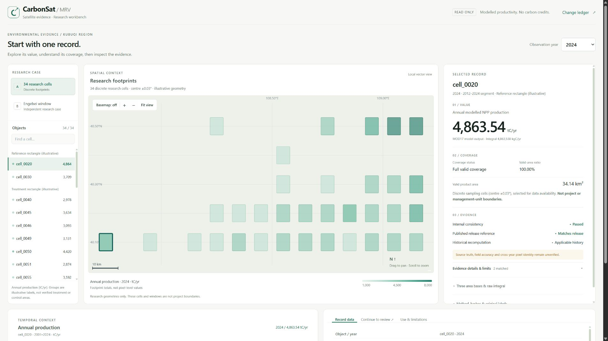

# CarbonSat-MRV

**Keep satellite results, coverage and supporting evidence together for environmental review.**

IEEE ClimateChain Global Hackathon 2026 · Track 4: Climate Data & Environmental Monitoring

CarbonSat-MRV helps researchers hand over satellite vegetation results that another reviewer can inspect and continue investigating. Two complementary offline anomaly-prescreening model families support the research materials; the English workbench connects record values, coverage and evidence with a rule-derived review handover. One historical Sepolia registration provides a public reference for its registered fields.



## Try CarbonSat-MRV

- [Open the English workbench](https://ryaniamemm-design.github.io/CarbonSat-MRV/web/workbench.html?case=A&object=cell_0020&year=2024)
- [Open the located change ledger](https://ryaniamemm-design.github.io/CarbonSat-MRV/web/changes.html?cell=cell_0020&era=2&year=2016)
- [Demo landing page](https://ryaniamemm-design.github.io/CarbonSat-MRV/)

## The review workflow

1. Select a research object and year.
2. Inspect modelled vegetation productivity, valid coverage and three separate area bases.
3. Examine evidence checks and their scope.
4. Follow the same record into an adjacent-year comparison.
5. Recompute the local ledger and export the complete review task list with its stable content digest.

Case A contains **816 cell-years from 34 cells, 2001–2024**. Case B is a separate Engebei research window with 24 years of partial coverage, approximately **93.12%**. The cases remain independent.

The ledger contains **748 within-segment differences**, explicitly refuses **34 cross-2012 pairs**, and derives **172 complete review tasks**. It compares the same cell inside one analysis segment. The task list is rule-derived and separate from offline model scores.

## Run the English prototype

From this repository's root:

```bash
python -m http.server 8777 --bind 127.0.0.1
```

Open **http://127.0.0.1:8777/web/workbench.html**. The linked ledger is at `web/changes.html`.

There is no frontend build step. Bundles are local; the optional basemap is off by default. Use HTTP rather than opening HTML files directly.

Current English demo: https://ryaniamemm-design.github.io/CarbonSat-MRV/web/workbench.html

The English workbench is published through the included GitHub Pages workflow. The same source can be served locally with the command above.

Historical hosted demo: https://carbonsat-mrv.app.workbuddy.link/?sharecode=LCOGLBOECZ

That earlier instance is retained as a historical reference and may show the previous interface. Use the current English demo for this submission.

## Two unsupervised model families

Both use **Isolation Forest** with features tailored to their input stream.

| Family | Input | Feature count | Evaluation structure |
|---|---|---|---|
| FVC v1.1 | 3,420 rows, 90 cells, 1987–2024 | 7 | 72 training cells / 18 held-out cells |
| NPP v1.0 | 816 rows, 34 cells, 2001–2024 | 8 | Separate formal, time-holdout and cell-holdout artifacts |

The FVC v1.1 repair consistently reuses the saved training imputer. The formal forest was not retrained. All 3,420 corrected FVC scores and 816 NPP scores can be checked using the supplied model artifacts and inputs.

```bash
python -m pip install -r ml/requirements.txt
python ml/tools/verify_models_readonly.py
python ml/project/pipeline/tests/test_fvc_preprocessing.py
```

See [the model guide](ml/README.md) for the exact environment and artifact roles. Scores provide advisory review priority. Independently labelled real anomalies are not available, so no real detection-accuracy claim is made. Synthetic injection results are process checks. Browser live inference is not part of this prototype.

## Data and interpretation

- MODIS `MODIS/061/MOD17A3HGF` v6.1 supplies modelled annual NPP.
- `MODIS/061/MCD12Q1` supplies land-cover context.
- Google Earth Engine reductions yield the derived aggregates stored here.
- The Engebei research window follows a published study extent: *IEEE Access*, DOI `10.1109/ACCESS.2023.3255879`.

Annual production integrates NPP density over valid pixel area and converts kgC/yr to tC/yr. Geometry area, reduction total area and valid area remain distinct. The configured 500 m reduction is not a claim of complete native-grid integration. No QC-threshold filtering of the displayed integrals is claimed.

NPP here describes **modelled vegetation productivity**. It does not establish net carbon removal, stock change, carbon credits or causal restoration effects. The 34 cells and Engebei research window are not official project boundaries. Equal valid area does not establish identical pixel locations across years.

We split the series at an observed 2012 break whose cause remains unresolved. Engebei's values represent each year's valid product footprint. The two cases are not merged or ranked.

Historical upstream sampling reproduced **9 of 840 object-years** under a stated protocol. The other 831 were not rerun. There is no field-accuracy validation or completed independent user study. Local consistency, release-reference agreement and historical source checks remain separate evidence layers.

## Blockchain reference

Exactly **one historical descriptive record**, `cell_0030_2012`, was registered on **Sepolia**:

| Item | Value |
|---|---|
| Chain ID | 11155111 |
| EvidenceAnchor contract | `0x248EFE2E5579613d47e9Abe743d7528fBECE3c88` |
| Registered metadata | Single-record payload `packHash`, `methodVersion`, `declarationCategory` |
| Method | `CarbonSat-NPP-Evidence-v1.0` |
| Category | `DESCRIPTIVE_NPP_ONLY` |

The record provides a public reference for those fields. The full bundle, Engebei case and review ledger are off-chain. Registration does not authenticate the source observations or establish scientific validity. Verification commands do not deploy contracts or send public transactions.

## Check the publication

```bash
python scripts/verify_release.py
node scripts/verify_workbench.js
node scripts/verify_engebei_case.js
node scripts/build_workbench_evidence_registry.js --verify
python scripts/verify_workbench_module.py --verify
```

These commands need Python standard-library support and Node.js. Model checks additionally need the packages in `ml/requirements.txt`.

The contract and integration suite requires the locked npm dependencies:

```bash
npm ci
npm test
```

`.npmrc` preserves the dependency resolution used by the existing project. Browser automation utilities in `scripts/` are development tools and are not part of the portable verification promise.

## Repository structure

| Directory | Contents |
|---|---|
| `web/` | English workbench, linked ledger, prepared bundles and historical evidence interfaces |
| `ml/` | Two model families, trusted saved artifacts, inputs and read-only reproduction |
| `data/` | Frozen derived satellite aggregates |
| `contracts/` | EvidenceAnchor, EvidenceMerkleAnchor and CarbonMRV implementations |
| `scripts/`, `test/` | Verification, preparation and regression/integration checks |
| `docs/`, `audit/` | Method contracts, historical evidence and publication scope |
| `presentation/` | Current twelve-slide English presentation |

## Publication and rights

[Publication S5](docs/PUBLICATION_S5.md) explains the source cleanup and distinguishes the current publication from historical byte manifests. Original scientific inputs, model artifacts, score tables and browser bundles are retained. Publication manifests establish byte integrity, not source authenticity or scientific accuracy.

The code is published for evaluation. **No open-source license is granted.** The existing `UNLICENSED` status is retained. Data attribution, third-party code and rights information are in [NOTICE.md](NOTICE.md).
